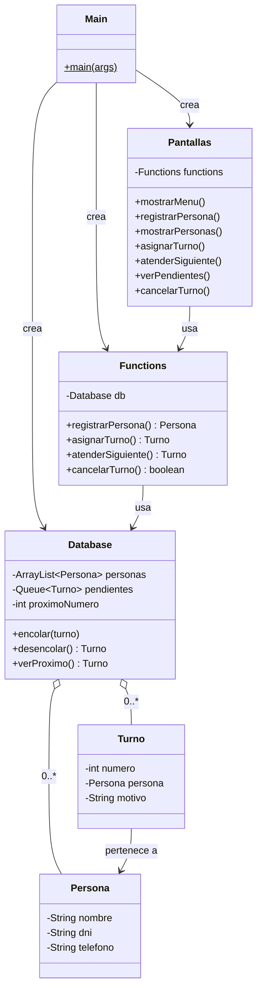

<div align="center">

# Sistema de Turnos

**Aplicación de consola en Java para registrar personas, asignar turnos y atender por orden de llegada.**


</div>

---

##  Contenido

- [Sobre el proyecto](#-sobre-el-proyecto)
- [Funcionalidades](#-funcionalidades)
- [Ejecución](#-ejecución)
- [Ejemplo de uso](#-ejemplo-de-uso)
- [Estructura del proyecto](#-estructura-del-proyecto)
- [Estructuras de datos](#-estructuras-de-datos)
- [Validaciones](#-validaciones)
- [Pruebas](#-pruebas)
- [Limitaciones y mejoras](#-limitaciones-y-mejoras)
- [Autor](#-autor)

---

## 📌 Sobre el proyecto

Permite registrar personas, asignarles turnos, **atender siempre al siguiente por orden de llegada**, ver los turnos pendientes y cancelarlos.

Trabajo práctico de Programación que integra **programación estructurada**, **POO** (clases, constructores, encapsulamiento) y una **estructura dinámica**: una **cola FIFO**.

## ✨ Funcionalidades

| Opción | Función | Descripción |
|:---:|---|---|
| `1` | Registrar persona | Guarda nombre y apellido, DNI y teléfono. No permite DNI repetido. |
| `2` | Mostrar personas registradas | Lista todas las personas cargadas en una tabla. |
| `3` | Asignar turno | Asigna un turno a una persona registrada y lo ubica al final de la cola. |
| `4` | Atender siguiente | Atiende al primero de la cola y muestra quién sigue. |
| `5` | Ver turnos pendientes | Muestra la cola completa en orden de llegada. |
| `6` | Cancelar turno | Cancela un turno pendiente por su número, previa confirmación. |
| `0` | Salir | Termina el programa. |

##  Ejecución

**Requisitos:** Java 8 o superior. No usa librerías externas.

Desde la terminal, dentro de la carpeta del proyecto:

```bash
javac *.java
java Main
```

También se puede abrir la carpeta en un IDE (IntelliJ, Eclipse, NetBeans o VS Code) y ejecutar la clase `Main`.

## 🖥️ Ejemplo de uso

```text
  +========================================+
  |           SISTEMA DE TURNOS            |
  +========================================+
  |  1. Registrar persona                  |
  |  2. Mostrar personas registradas       |
  |  3. Asignar turno                      |
  |  4. Atender siguiente                  |
  |  5. Ver turnos pendientes              |
  |  6. Cancelar turno                     |
  |  0. Salir                              |
  +----------------------------------------+
  |  Turnos en espera: 2                   |
  +----------------------------------------+
  Elija una opcion: 4

  >> ATENDER SIGUIENTE
  [OK] Atendiendo ahora:
      Turno nro : 1
      Persona   : Fran Foglia (DNI 30123456)
      Motivo    : Control general
  Quedan 1 en espera. Sigue: Benja Wendt (turno 2)
```

## 🗂️ Estructura del proyecto

```text
SistemaTurnos/
├── Main.java        → Arranca el programa y repite el menú hasta salir
├── Pantallas.java   → Todo lo que ve y escribe el usuario (menú y las 6 opciones)
├── Functions.java   → Lógica del sistema; es el único que habla con Database
├── Database.java    → Guarda los datos: lista de personas y cola de turnos
├── Persona.java     → Modelo de persona y sus validaciones
└── Turno.java       → Modelo de turno y sus validaciones
```

### Responsabilidades

| Clase | Qué hace |
|---|---|
| **Main** | Crea los objetos y los conecta entre sí. No tiene lógica. |
| **Pantallas** | Pide datos, llama a `Functions` y muestra los resultados. No valida reglas de negocio. |
| **Functions** | Aplica las reglas del sistema (DNI único, un turno pendiente por persona, etc.). |
| **Database** | Almacena los datos y devuelve copias, para que nadie modifique las estructuras sin pasar por el sistema. |
| **Persona** y **Turno** | Representan los datos y validan sus propios campos. |

### Diagrama de clases



## 📚 Estructuras de datos

| Estructura | Dónde | Por qué |
|---|---|---|
| **Cola FIFO** (`Queue` con `LinkedList`) | Turnos pendientes | Los turnos se atienden por orden de llegada: sale primero quien entró primero. |
| **Lista** (`ArrayList`) | Personas registradas | Hay que agregar, recorrer y buscar por DNI. |

**Operaciones de la cola:**

| Operación | Método | Uso en el sistema |
|---|---|---|
| enqueue | `offer` | Asignar turno |
| dequeue | `poll` | Atender siguiente |
| peek | `peek` | Ver quién sigue |
| quitar uno | `remove` | Cancelar turno |

##  Validaciones

| Dato | Regla | Mensaje si falla |
|---|---|---|
| Nombre y apellido | No vacío, máximo 25 caracteres | El nombre no puede estar vacío / no puede superar los 25 caracteres |
| DNI | Solo números, 7 u 8 dígitos, no repetido | El DNI debe tener 7 u 8 números / El DNI ya está registrado a nombre de: ... |
| Teléfono | Solo números, entre 6 y 15 dígitos | El teléfono debe tener entre 6 y 15 números |
| Motivo del turno | No vacío, máximo 67 caracteres | El motivo no puede estar vacío / no puede superar los 67 caracteres |
| Asignar turno | La persona debe estar registrada y no tener otro turno pendiente | No hay ninguna persona registrada con ese DNI / Esa persona ya tiene un turno pendiente |
| Atender, ver o cancelar | Si no hay datos, se avisa sin cerrar el programa | No hay turnos pendientes / No hay un turno pendiente con ese número |
| Menú | Solo se aceptan números del 0 al 6 | Opción inválida. Elija de 0 a 6 |

##  Pruebas

### Prueba de escritorio

Seguimiento de la cola con tres turnos:

| Paso | Operación | Cola (frente → final) |
|:---:|---|---|
| 1 | Asignar turno a Ana | `[T1-Ana]` |
| 2 | Asignar turno a Luis | `[T1-Ana, T2-Luis]` |
| 3 | Asignar turno a Mia | `[T1-Ana, T2-Luis, T3-Mia]` |
| 4 | Atender siguiente | `[T2-Luis, T3-Mia]` (sale Ana) |
| 5 | Atender siguiente | `[T3-Mia]` (sale Luis) |

<details>
<summary><b>Pruebas funcionales (17 casos)</b></summary>

<br>

| Caso | Resultado |
|---|---|
| Registrar persona con datos válidos | ✅ Correcto |
| Nombre vacío | ✅ Se rechaza |
| Nombre mayor a 25 caracteres | ✅ Se rechaza |
| DNI con letras | ✅ Se rechaza |
| DNI con 6 o 9 caracteres | ✅ Se rechaza |
| DNI duplicado | ✅ Se rechaza e informa el nombre de la persona registrada |
| Teléfono con letras | ✅ Se rechaza |
| Teléfono fuera de 6 a 15 dígitos | ✅ Se rechaza |
| Motivo vacío | ✅ Se rechaza |
| Asignar turno a persona inexistente | ✅ Se rechaza |
| Segundo turno pendiente para la misma persona | ✅ Se rechaza |
| Atender con cola vacía | ✅ Muestra aviso |
| Atención por orden de llegada (FIFO) | ✅ Correcta |
| Cancelación confirmada | ✅ Correcta |
| Cancelación de turno inexistente | ✅ Muestra aviso |
| Opción inválida en el menú | ✅ Muestra error y vuelve al menú |
| Listas vacías | ✅ Muestran aviso |

</details>

> **Resultado de QA:** aprobado con observaciones menores. El proyecto compila y los flujos principales funcionan.

## 🔧 Limitaciones y mejoras

**Limitaciones**
- Los datos se guardan solo en memoria: al cerrar el programa se pierden.
- No hay prioridades: todos los turnos se atienden por orden de llegada.

**Posibles mejoras**
- [ ] Guardar los datos en un archivo para conservarlos entre ejecuciones.
- [ ] Agregar fecha y hora a los turnos.
- [ ] Incorporar prioridades (por ejemplo, adultos mayores) con una cola de prioridad.

## Autor

**Facundo Lopez Mendoza**
Programación · 6to 2da · G1
Profesora Dolores Bengochea
